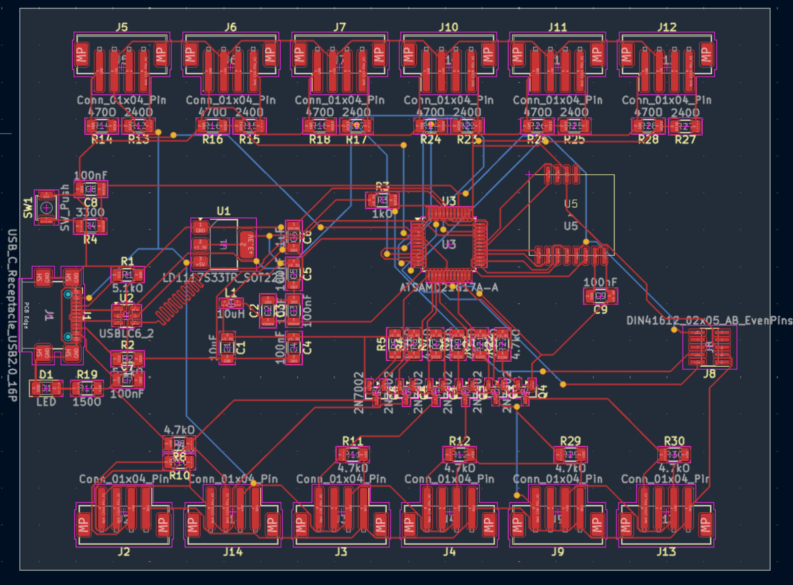

## Overview

The Climate Tree is a LoRaWAN sensor node that measures soil and climate conditions (temperature, humidity, soil moisture, pH) and reports them to The Things Network (TTN). I designed and deployed a network of 5 nodes across ~8,900 m² of a working farm; they doubled as live demos on student tours.

## v1 – Dev-Board Nodes

- Wrote C++ firmware for RP2040 sensor nodes to read the sensors, pack compact LoRaWAN payloads and handle uplinks.
- Refactored the firmware into a modular, object-oriented driver design (one class per sensor), so new sensors can be added without touching the rest of the code.
- Set up an ESP32 LoRaWAN-to-WiFi gateway and the TTN application (device registration, keys, payload decoding) to connect the field nodes to the cloud dashboard.

## v2 – Custom PCB

The dev-board nodes were expensive and had too few analog inputs, so I led the move to a custom PCB over 3 design revisions.

- Designed the schematic around a SAMD21G17A (ARM Cortex-M0+) with USB-C and TVS ESD protection, power-rail filtering, buffered analog inputs (5 V sensors protected at the 3.3 V ADC), an SX1262 LoRa transceiver over SPI, and I²C sensor headers.
- Built and brought up prototypes in-house on a Voltera V1 PCB printer, adapting KiCad design rules (DRC) to the printer's manufacturing limits.
- Cut unit cost 58% ($60 → $25) and tripled the analog inputs (2 → 6).
